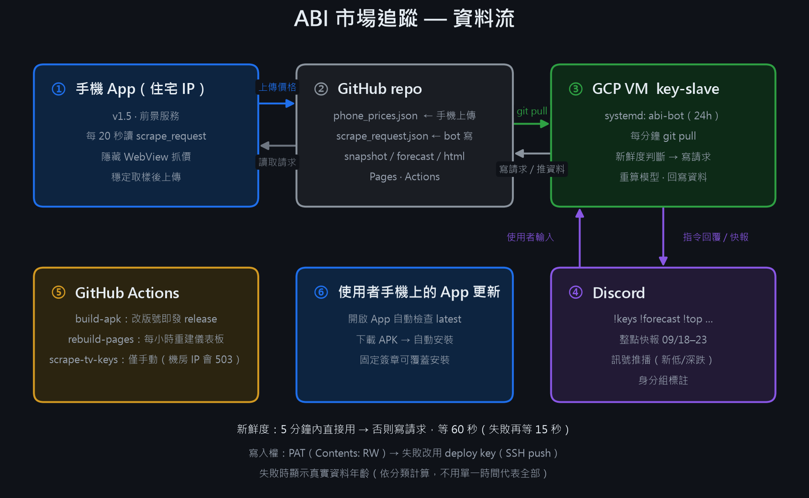
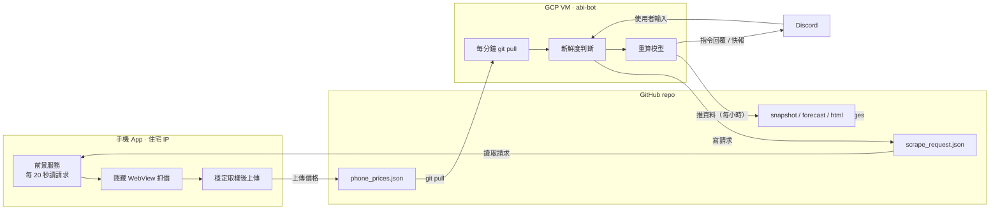

# 資料流圖

## Mermaid 版（可貼到 GitHub / Notion）

## 一次 `!top` 的完整流程

1. 使用者輸入 `!top`
2. bot 用 `quote_time_for("40801,...,40814")` 算雜物資料年齡
3. 若 > 5 分鐘 → `_request_phone()` 寫 `scrape_request.json`
4. App 20 秒內看到新 `id` → 逐一分類抓（13 頁，約 1~3 分鐘）
5. App 上傳 `phone_prices.json`（`req` 對應請求 id）
6. bot 每 5 秒 pull，看到新資料 → `_rebuild_models()` 重算 `snapshot.json` + `forecast.json`
7. bot 回覆；`_push_data()` 每小時把資料推回 repo
8. `rebuild-pages` workflow 每小時重建 `dashboard.html`

## 例外路徑

| 情況 | 行為 |
|---|---|
| 資料 ≤ 5 分鐘 | 直接回覆，不吵手機 |
| 寫入 403（PAT 唯讀）| 自動改用 deploy key（SSH push）|
| 寫入全失敗 | 顯示錯誤原因＋真實資料年齡，仍回覆舊資料 |
| 手機 75 秒沒回報 | 顯示「手機沒有回報」，附舊資料 |
| 手機沒開／沒權限 | App 收不到請求，資料停在最後一次上傳 |
